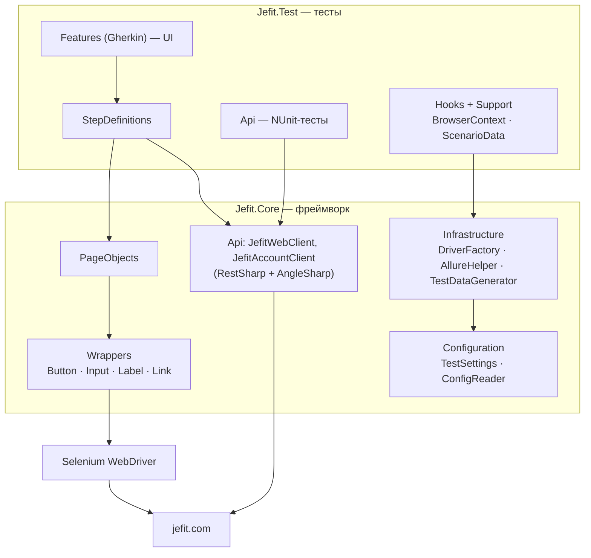

# Архитектура фреймворка

## Слои

`Jefit.Core` ничего не знает о тестах и SpecFlow — его можно подключить к другому тестовому проекту.

## Как устроены страницы

- **Обёртки элементов** (`Wrappers`): элемент ищется заново при каждом обращении с явным ожиданием. Поэтому нет `StaleElementReferenceException`, хотя сайт (Next.js) постоянно перерисовывает DOM. Кнопка при перекрытии кликается через JavaScript, поле ввода очищается и через `Clear()`, и через выделение текста (у React-полей `Clear()` иногда не срабатывает).
- **BasePage**: объект страницы создаётся, когда страница уже открыта. Конструктор ждёт загрузку документа, закрывает cookie-баннер и вызывает абстрактный `WaitForPageLoad()` — каждая страница сама проверяет свой ключевой элемент.
- **Переходы**: статический `Open()` открывает страницу и возвращает её объект; действия, ведущие на другую страницу, возвращают объект новой страницы (`OpenExercise()` → `ExerciseDetailsPage`).
- **Секции**: `FooterSection`, `CookieBanner` — блоки, общие для всех страниц.

## Паттерны

| Паттерн | Где |
|---|---|
| Page Object, Page Section | `PageObjects/`, `FooterSection`, `CookieBanner` |
| Element Wrapper | `Wrappers/` |
| Template Method | `BasePage.WaitForPageLoad()`, `BaseApiClient.SendAsync()` |
| Factory Method | `DriverFactory.CreateDriver()` |
| Singleton (Lazy, потокобезопасный) | `ConfigReader` |
| Dependency Injection (Context Injection SpecFlow) | `BrowserContext`, `ScenarioData`, клиенты API |
| Test Data Generator | `TestDataGenerator` (Bogus) |

## Отчётность

`Allure.SpecFlow` строит шаги из Gherkin, `Allure.NUnit` (`[AllureNUnit]`) — отчёт по API-тестам. Пакеты одной версии (2.12.1), поэтому используют одно ядро и пишут в одну папку `allure-results`. `AllureHelper` прикладывает каждый HTTP-запрос, скриншот/URL/HTML при падении, `environment.properties` и `categories.json`.

## Возможные вопросы на защите

**Почему неявное ожидание по умолчанию 0?** Во фреймворке используются явные ожидания (`WebDriverWait`). Если включить и неявное, Selenium не гарантирует, как они сложатся: каждая попытка явного ожидания может ждать ещё и неявное время. Документация Selenium прямо не рекомендует их смешивать.

**Почему `WaitForPageLoad()` из конструктора не ломается?** Абстрактный метод вызывается из конструктора базового класса раньше, чем выполнится конструктор наследника. Поэтому элементы в наследниках — свойства (`=> new Button(...)`), а не поля, которые заполняются в конструкторе: они создаются в момент обращения.

**Почему хуки браузера с тегом `@ui`?** Хук `[BeforeScenario]` без тега в любом `[Binding]`-классе выполняется для **всех** сценариев проекта. Если открывать в нём браузер, он откроется и для сценариев, которым не нужен.

**Как устроена параллельность?** `ParallelScope.Fixtures`: классы тестов и feature-файлы идут параллельно, тесты внутри — последовательно. Нет статических драйверов: у каждого сценария свой браузер через Context Injection, у каждого API-теста свой клиент.

**Почему API-тесты — это HTML, а не JSON?** У Jefit нет публичного API. Сайт рендерится на сервере, поэтому HTTP-ответ уже содержит данные (упражнения, планы, SEO-теги): это и есть контракт, который видит браузер и поисковики.
