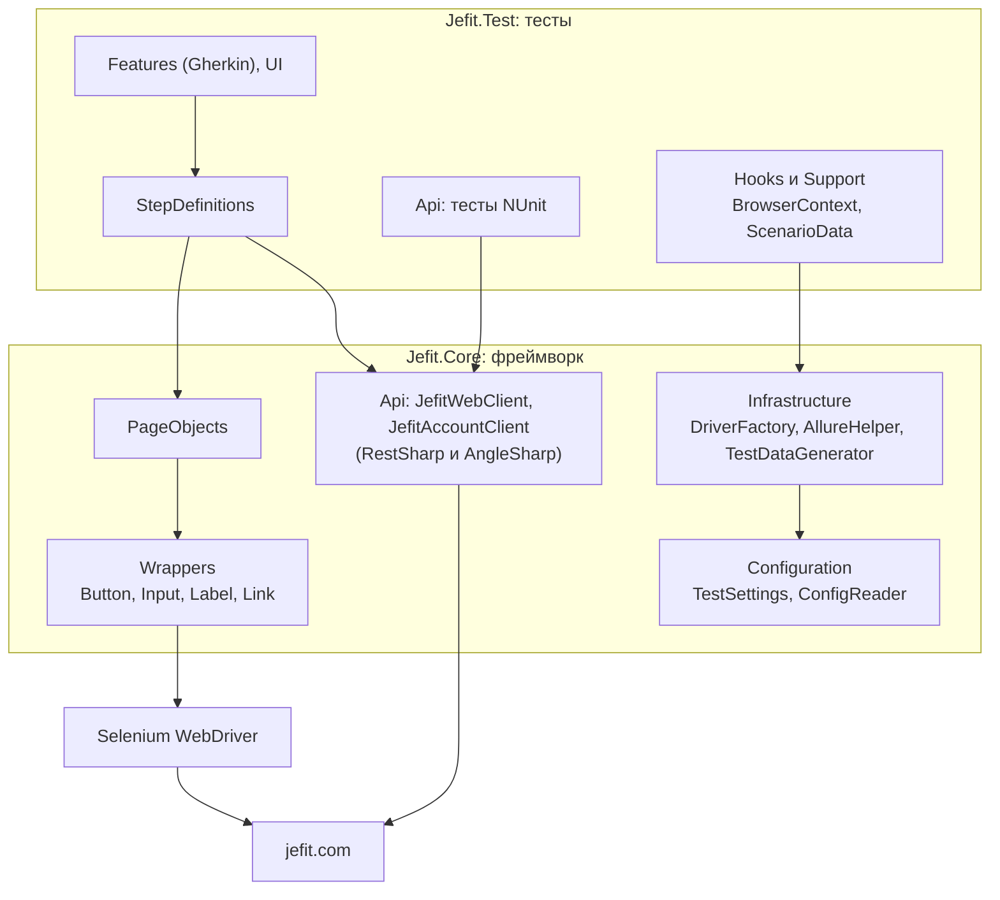
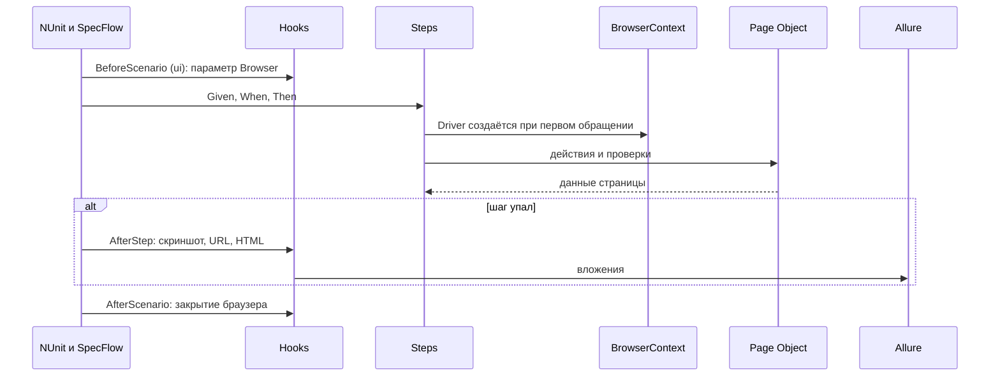

# Архитектура фреймворка

## Слои

`Jefit.Core` ничего не знает о тестах и SpecFlow: его можно подключить к другому тестовому проекту.

## Как устроены страницы

- **Обёртки элементов** (`Wrappers`): элемент ищется заново при каждом обращении с явным ожиданием. Поэтому нет ошибок устаревших элементов, хотя сайт (Next.js) постоянно перерисовывает страницу. Кнопка при перекрытии кликается через JavaScript, поле ввода очищается и через `Clear()`, и через выделение текста.
- **BasePage:** объект страницы создаётся, когда страница уже открыта. Конструктор ждёт загрузку документа, закрывает cookie-баннер и вызывает абстрактный `WaitForPageLoad()`: каждая страница сама проверяет свой ключевой элемент. Для страниц, которые рисуются скриптами, при необходимости один раз перезагружается страница.
- **Переходы:** статический `Open()` открывает страницу и возвращает её объект; действия, ведущие на другую страницу, возвращают объект новой страницы.
- **Секции:** `FooterSection` и `CookieBanner` общие для всех страниц.

## Паттерны

| Паттерн | Где |
|---|---|
| Page Object, Page Section | `PageObjects/`, `FooterSection`, `CookieBanner` |
| Element Wrapper | `Wrappers/` |
| Template Method | `BasePage.WaitForPageLoad()`, `BaseApiClient.SendAsync()` |
| Factory Method | `DriverFactory.CreateDriver()` |
| Singleton (Lazy, потокобезопасный) | `ConfigReader` |
| Внедрение зависимостей (Context Injection SpecFlow) | `BrowserContext`, `ScenarioData`, клиенты API |
| Генератор данных | `TestDataGenerator` (Bogus) |

## Жизненный цикл UI-сценария

## Данные для тестов через API

- **Публичная часть.** Сценарии из `ApiPreparedData.feature` получают данные с сайта через RestSharp до UI-проверки: запрашивается список упражнений или планов, HTML разбирается AngleSharp, выбирается случайный элемент, и только затем браузер проверяет, что страница показывает именно его.
- **Аккаунт.** Сценарий из `AccountData.feature`: вход через API (пароль отправляется как MD5-хеш, как это делает сайт), добавление готового плана из каталога в «Мои планы», перенос cookie сессии в браузер (`SessionTransfer`), проверка плана в интерфейсе. Завершающий хук удаляет план, в том числе если тест упал.

## Параллельность

- `[assembly: Parallelizable(ParallelScope.Fixtures)]`: feature-файлы и классы тестов идут параллельно, `LevelOfParallelism(4)`.
- Нет статических драйверов и общего изменяемого состояния: всё, что меняется, живёт в объектах сценария.
- Число потоков меняется без перекомпиляции через `NumberOfTestWorkers` в `.runsettings`.

## Отчётность

`Allure.SpecFlow` строит шаги отчёта из Gherkin, `Allure.NUnit` строит отчёт по API-тестам. Пакеты одной версии (2.12.1), поэтому используют одно ядро и пишут в одну папку `allure-results`. `AllureHelper` добавляет вложения: каждый HTTP-вызов (метод, адрес, статус, время, тело без токенов и личных данных), скриншот, адрес и HTML страницы при падении, `environment.properties` и `categories.json`.

## Что решали на практике

| Проблема | Решение |
|---|---|
| Сайт отвечает до 14 секунд | Лимиты в настройках; при зависшей загрузке `window.stop()`; повтор HTTP-запроса, если ответа нет |
| Кнопки оживают позже, чем видна страница | Перед кликом ждём, пока JavaScript сайта подключится к кнопке |
| Cookie-баннер перехватывает клик | Закрываем баннер кликом через JavaScript |
| Next.js перерисовывает страницу | Обёртки ищут элемент заново при каждом обращении |
| У страницы плана нет заголовка h1 | Берём заголовок h2, если h1 нет |
| Edge в облачном CI грузит сайт дольше минуты | В CI Chrome и Firefox, Edge не используется |

## Возможные вопросы на защите

**Почему неявное ожидание равно нулю?** Во фреймворке используются явные ожидания (`WebDriverWait`). Если включить ещё и неявное, Selenium не гарантирует, как они сложатся, и задержки становятся непредсказуемыми.

**Почему `WaitForPageLoad()` из конструктора не ломается?** Абстрактный метод вызывается из конструктора базового класса раньше, чем выполнится конструктор наследника. Поэтому элементы в наследниках объявлены как свойства (`=> new Button(...)`), а не как поля, заполняемые в конструкторе.

**Почему хуки браузера привязаны к тегу `ui`?** Хук `[BeforeScenario]` без тега выполняется для всех сценариев проекта. Если открывать в нём браузер, он откроется и там, где не нужен.

**Как устроена параллельность?** `ParallelScope.Fixtures`: классы тестов и feature-файлы идут параллельно, тесты внутри набора последовательно. Нет статических драйверов, у каждого сценария свой браузер, у каждого API-теста свой клиент.

**Почему API-тесты проверяют HTML, а не JSON?** У Jefit нет публичного API. Сайт рендерится на сервере, поэтому ответ уже содержит данные (упражнения, планы, SEO-теги). Это контракт, который видят и браузер, и поисковики. Для аккаунта использованы настоящие JSON-эндпоинты сайта.

**Почему SpecFlow, ведь он закрыт?** Задание предписывает SpecFlow. Проект прекратил существование 31 декабря 2024 года, его преемник Reqnroll совместим с ним по синтаксису, и переход сводится к замене пакетов и пространства имён.

**Почему Edge не используется?** В облачном CI на Linux Edge открывал страницы сайта дольше минуты и давал нестабильные результаты. Кросс-браузерность обеспечивают Chrome и Firefox.
